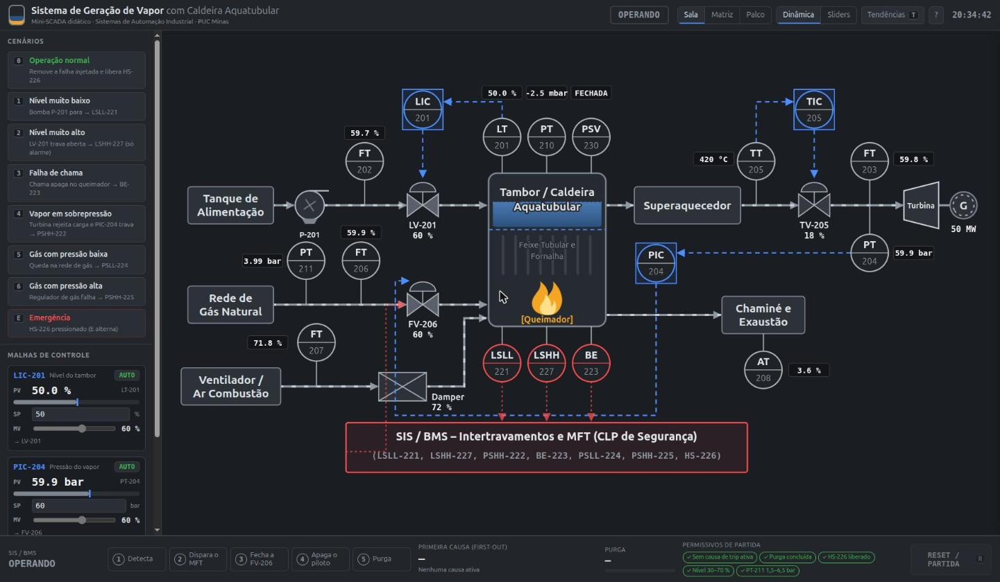

# Sistema de Geração de Vapor com Caldeira Aquatubular — Mini-SCADA

Simulador didático de uma caldeira aquatubular a gás natural de usina termelétrica, feito para a
demonstração do **TP 01 de Sistemas de Automação Industrial (PUC Minas, 2º/2026)**.

O foco é mostrar **o SIS/BMS atuando**: a causa é detectada, o **Master Fuel Trip** dispara e a sequência
de segurança acontece passo a passo — detecta → MFT → fecha FV-206 → apaga o piloto → purga — até que
os permissivos liberem uma nova partida.

Grupo: Lucas Dias Borges · Marcus Prado Silva · Marlon Bento Azevedo

**▶ Abrir o simulador:** <https://marcusprado02.github.io/TP_01_Sistemas-_de_Automa-o_Industrial_PUC_MG_02_2026/>

**📘 Tutorial completo de uso:** [TUTORIAL.md](TUTORIAL.md)



## Como rodar

Não há instalação nem build: é HTML, CSS e JavaScript puro.

- **Online:** <https://marcusprado02.github.io/TP_01_Sistemas-_de_Automa-o_Industrial_PUC_MG_02_2026/>
- **Local:** os módulos ES não carregam via `file://`, então sirva a pasta:

```bash
python3 -m http.server 8080
# abra http://localhost:8080
```

## Como apresentar

Fluxo por cenário (≈ 45 s): **tecla do cenário → trip → purga (30 s) → `0` → `R`**.

| Tecla | Ação |
|---|---|
| `0` | Operação normal (remove a falha injetada e libera HS-226) |
| `1` | Nível muito baixo — bomba P-201 para → LSLL-221 |
| `2` | Nível muito alto — LV-201 trava aberta → LSHH-227 (só alarme, sem trip) |
| `3` | Falha de chama → BE-223 |
| `4` | Vapor em sobrepressão — turbina rejeita carga e PIC-204 trava → PSHH-222 |
| `5` | Gás com pressão baixa → PSLL-224 |
| `6` | Gás com pressão alta → PSHH-225 |
| `E` | Emergência HS-226 (alterna pressionado/liberado) |
| `R` | RESET / partida (só com purga concluída e permissivos OK) |
| `A` | Reconhecer alarmes |
| `M` | Layout: **Sala** (padrão) → **Matriz** → **Palco** |
| `S` | Fonte de dados: **Dinâmica** ↔ **Sliders** |
| `T` | Tendências e registro de alarmes |
| `P` | Pausa |
| `G` | Tour guiado pela interface |
| `D` | Narrador "O que está acontecendo?" |

**Layouts**

- **Sala de controle** — cenários e faceplates à esquerda, sinótico no centro, faixa do SIS fixa no rodapé.
- **Matriz** — sinótico + matriz de causa e efeito acendendo ao vivo.
- **Palco** — sinótico em tela cheia; no trip, um painel grande do SIS aparece por cima.

**Fontes de dados**

- **Dinâmica** — a planta evolui no tempo; os cenários injetam falhas reais e a dinâmica leva ao limite.
- **Sliders** — a dinâmica pausa e cada transmissor vira um slider; o SIS avalia direto o valor arrastado.

## A planta

Referência: [`docs/referencia/pid-planta.png`](docs/referencia/pid-planta.png).

**Transmissores (10):** LT-201 nível do tambor · FT-202 água de alimentação · FT-203 vapor · PT-204 pressão do
vapor · TT-205 temperatura do vapor · FT-206 gás natural · FT-207 ar de combustão · AT-208 O₂ na exaustão ·
PT-210 pressão da fornalha · PT-211 pressão de suprimento de gás. Também PSV-230 no tambor.

**Malhas de controle**

| Malha | Medição → Controlador → Atuador | SP |
|---|---|---|
| Nível | LT-201 → LIC-201 → LV-201 | 50 % |
| Pressão | PT-204 → PIC-204 → FV-206 | 60 bar |
| Temperatura | TT-205 → TIC-205 → TV-205 (spray) | 420 °C |

Cada faceplate tem AUTO/MAN, SP editável e saída manual. **A segurança tem prioridade:** com MFT ativo a
FV-206 fica fechada mesmo com o PIC-204 em MAN.

**Matriz de causa e efeito**

| TAG | Evento | Limite | Efeito |
|---|---|---|---|
| LSLL-221 | Nível muito baixo | LT-201 < 15 % | MFT |
| LSHH-227 | Nível muito alto | LT-201 > 85 % | Alarme + fecha LV-201 (sem MFT) |
| PSHH-222 | Pressão de vapor muito alta | PT-204 > 75 bar | MFT |
| BE-223 | Perda de chama | digital | MFT |
| PSLL-224 | Gás com pressão muito baixa | PT-211 < 1,5 bar | MFT |
| PSHH-225 | Gás com pressão muito alta | PT-211 > 6,5 bar | MFT |
| HS-226 | Botão de emergência | digital | MFT + bloqueia partida |

`MFT = LSLL-221 OR PSHH-222 OR BE-223 OR PSLL-224 OR PSHH-225 OR HS-226`

O MFT é **travado** (latch): a causa sumir não religa a caldeira. Todo MFT executa a sequência completa
(fecha FV-206, apaga o piloto, purga com damper a 100 %). A primeira causa fica registrada (*first-out*).

**Permissivos de partida:** sem causa de trip ativa · purga concluída · HS-226 liberado · nível 30–70 % ·
PT-211 entre 1,5 e 6,5 bar.

## Estrutura

```
index.html            página
css/style.css         visual (IHM de alto desempenho, ISA-101)
js/config.js          TAGs, limites, malhas, cenários
js/plant.js           modelo dinâmico didático da caldeira
js/pid.js             controlador PI com anti-windup
js/sis.js             intertravamentos e máquina de estados do BMS
js/simulator.js       junta planta + malhas + SIS (sem DOM)
js/teaching.js        narrador, dicas e passos do tour (sem DOM)
js/ui/                sinótico SVG e painéis
tests/                testes da lógica (node --test)
```

## Testes

```bash
npm test     # ou: node --test tests/*.test.js
```

Cobrem os limites exatos de cada intertravamento, o latch do MFT, LSHH-227 sem trip, FV-206 fechada mesmo em
MAN, permissivos bloqueando o reset e o ciclo completo de cada cenário (trip → purga → partida sem novo trip).

## Observação

O modelo é didático (dinâmicas de primeira ordem ajustadas para reagir em segundos), não uma simulação
termodinâmica rigorosa. A purga foi encurtada para 30 s para caber na apresentação.
