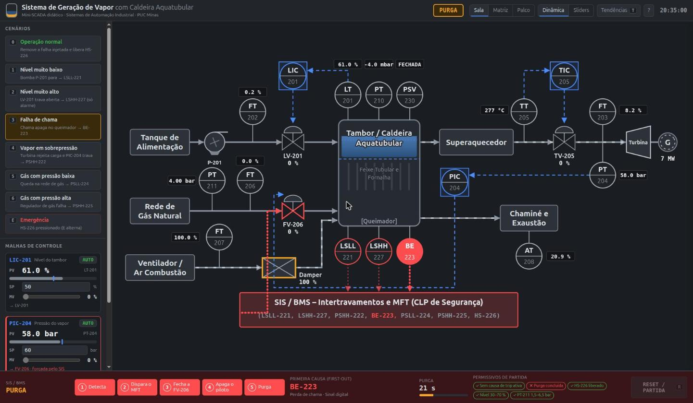
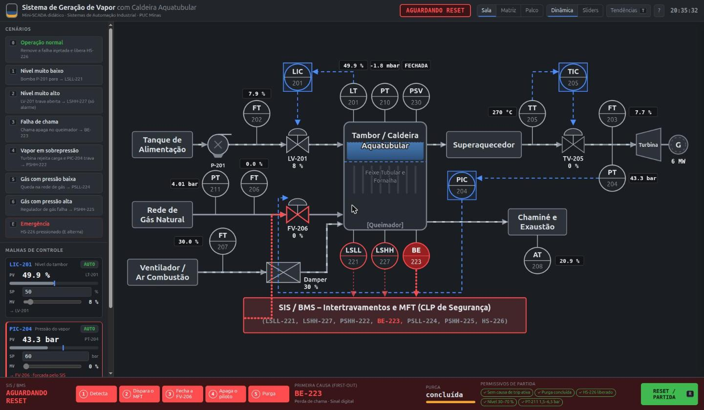
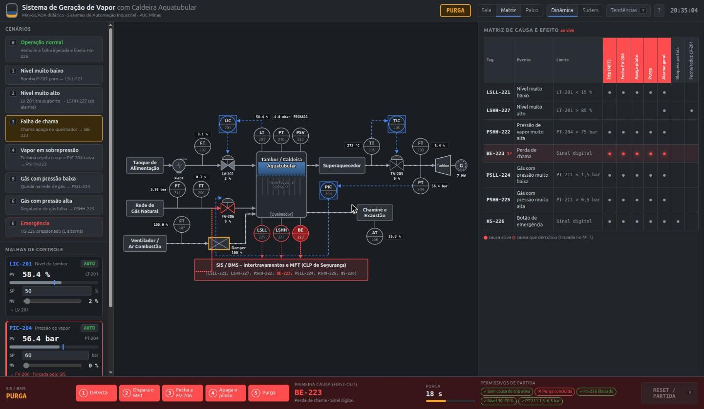
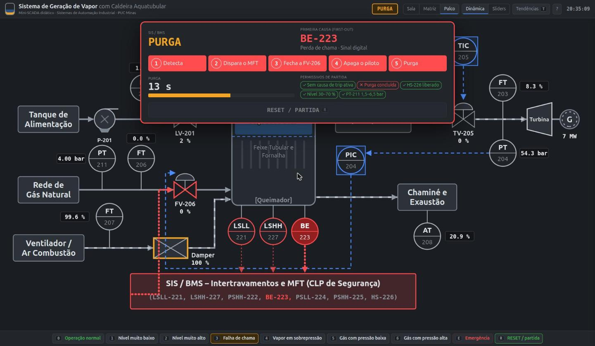
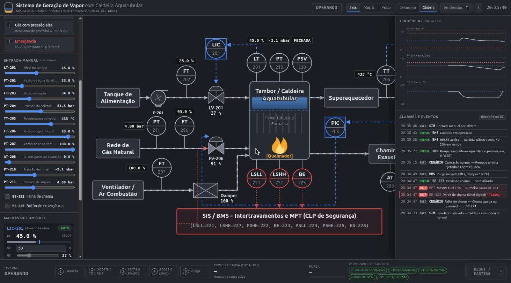

# Tutorial — Mini-SCADA da Caldeira Aquatubular

Guia completo de uso do simulador **Sistema de Geração de Vapor com Caldeira Aquatubular**: o que cada parte da
tela mostra, como operar as malhas, como provocar cada falha e como conduzir a demonstração do SIS na apresentação.

**Abrir o simulador:** <https://marcusprado02.github.io/TP_01_Sistemas-_de_Automa-o_Industrial_PUC_MG_02_2026/>

---

## Sumário

1. [Como abrir](#1-como-abrir)
   - [Aprendendo dentro do simulador](#aprendendo-dentro-do-simulador)
2. [Conhecendo a tela](#2-conhecendo-a-tela)
3. [Lendo o sinótico](#3-lendo-o-sinótico)
4. [Malhas de controle e faceplates](#4-malhas-de-controle-e-faceplates)
5. [O SIS / BMS e o Master Fuel Trip](#5-o-sis--bms-e-o-master-fuel-trip)
6. [Os cenários, um a um](#6-os-cenários-um-a-um)
7. [Os três layouts](#7-os-três-layouts)
8. [Entrada manual por sliders](#8-entrada-manual-por-sliders)
9. [Tendências e registro de alarmes](#9-tendências-e-registro-de-alarmes)
10. [Atalhos de teclado](#10-atalhos-de-teclado)
11. [Roteiro sugerido para a apresentação](#11-roteiro-sugerido-para-a-apresentação)
12. [Problemas comuns](#12-problemas-comuns)

---

## 1. Como abrir

**Pelo link (recomendado):** abra o endereço acima em qualquer navegador atual (Chrome, Edge, Firefox).
Não precisa instalar nada e funciona offline depois de carregado.

**Localmente:** baixe o repositório e sirva a pasta com um servidor simples. Abrir o `index.html` com
duplo clique **não funciona**, porque o navegador bloqueia módulos JavaScript via `file://`.

```bash
git clone https://github.com/marcusPrado02/TP_01_Sistemas-_de_Automa-o_Industrial_PUC_MG_02_2026.git
cd TP_01_Sistemas-_de_Automa-o_Industrial_PUC_MG_02_2026
python3 -m http.server 8080
# abra http://localhost:8080
```

> **Dica para o projetor:** use o navegador em tela cheia (`F11`). A interface foi pensada para 1366×768 ou
> maior. Se as letras ficarem pequenas, dê zoom com `Ctrl` + `+`.

### Aprendendo dentro do simulador

A própria interface ensina a usá-la, com três recursos:

| Recurso | Como abrir | O que faz |
|---|---|---|
| **Tour guiado** | Botão **Aprender** ou tecla `G` | 11 passos que destacam cada região da tela com um balão explicativo. Navegue com `←` `→` ou pelos botões; `Esc` sai. |
| **Narrador "O que está acontecendo?"** | Ligado por padrão; botão **Narrador** ou tecla `D` | Faixa acima do rodapé que explica em tempo real o que a planta e o SIS estão fazendo, e indica a próxima tecla a apertar (ex.: "`0` remover a falha", "`R` RESET / partida"). |
| **Dicas ao passar o mouse** | Passe o mouse sobre o sinótico | Cartão com o que é o instrumento ou equipamento, para que serve, seus limites e o valor atual. |

O narrador acompanha todo o ciclo: explica a falha **antes** do trip ("a bomba P-201 parou… o nível cai — LT-201 =
23,4 %; o LSLL-221 atua em 15 %"), narra cada um dos 5 passos do MFT, diz por que a purga existe e, depois dela,
qual permissivo ainda falta para religar. Durante a apresentação, ele funciona como legenda para a turma.

---

## 2. Conhecendo a tela


A tela tem quatro regiões:

| Região | O que tem |
|---|---|
| **Barra superior** | Título, **selo de estado do BMS** (OPERANDO, TRIP, PURGA, AGUARDANDO RESET, PARTIDA), seletor de **layout** (Sala / Matriz / Palco), seletor de **fonte de dados** (Dinâmica / Sliders), botões **Aprender** (tour), **Narrador**, **Tendências** e **?** (atalhos). |
| **Painel esquerdo** | **Cenários** (botões de falha), **Entrada manual** (só no modo Sliders) e **Malhas de controle** (faceplates). |
| **Centro** | **Sinótico P&ID** da planta, animado e com valores ao vivo. |
| **Narrador** | Faixa "O que está acontecendo?" explicando o momento atual e a próxima ação (tecla `D` liga/desliga). |
| **Rodapé** | **Faixa do SIS / BMS**: estado, os 5 passos da sequência de trip, primeira causa, purga, permissivos e botão **RESET / PARTIDA**. |

### Linguagem visual

A tela segue a filosofia de **IHM de alto desempenho (ISA-101)**: tudo é cinza enquanto está normal, e **cor só
aparece quando algo precisa de atenção**.

| Cor | Significado |
|---|---|
| Cinza | Normal |
| **Azul** | Controle (linhas tracejadas, controladores LIC/PIC/TIC, setpoints) |
| **Vermelho** | SIS, trip, alarme crítico, causa ativa |
| **Âmbar** | Alarme sem trip, purga, cenário selecionado, chama |
| **Verde** | Permissivo atendido, RESET liberado, partida |

As linhas seguem a mesma convenção do slide 7 do deck:

- **Contínua cinza** — processo (água, vapor, gás, ar, gases de combustão)
- **Tracejada azul** — sinal de controle
- **Pontilhada vermelha** — sinal do SIS / BMS

---

## 3. Lendo o sinótico

O sinótico reproduz o P&ID do trabalho (`docs/referencia/pid-planta.png`), com as TAGs da série 2xx.

**Caminho da água e do vapor (linha de cima):** Tanque de alimentação → bomba **P-201** → **LV-201** → **Tambor /
Caldeira** → **Superaquecedor** → **TV-205** → **Turbina** → **Gerador (G)**.

**Combustão (lado esquerdo):** Rede de gás natural → **FV-206** → queimador. Ventilador → **Damper** → fornalha.
Os gases saem para a **Chaminé e exaustão**.

**O que se mexe na tela:**

| Elemento | Comportamento |
|---|---|
| Linhas de processo | Tracejado em movimento quando há vazão |
| Tambor | Faixa azul mostra o **nível** (LT-201); a linha azul tracejada é o setpoint de 50 % |
| Queimador | **Chama** acesa quando há combustão; apaga no trip |
| Bomba P-201 | Rotor gira; fica com contorno vermelho se a bomba falhar |
| Válvulas | Preenchimento proporcional à abertura; o número abaixo é a % de abertura. FV-206 fechada fica vermelha |
| Damper | % de abertura; contorno âmbar durante a purga |
| Turbina / Gerador | Anel do gerador gira; abaixo, a potência estimada em MW |
| PSV-230 | Mostra FECHADA, ou ALIVIANDO se a pressão passar de 85 bar |

**Instrumentos:** cada balão mostra a TAG (letras em cima, número embaixo) e, ao lado, uma **caixa preta com o
valor medido**. Os 10 transmissores são:

| TAG | Mede | Valor normal |
|---|---|---|
| LT-201 | Nível do tambor | 50 % |
| FT-202 | Vazão de água de alimentação | ~60 % |
| FT-203 | Vazão de vapor | ~60 % |
| PT-204 | Pressão do vapor | 60 bar |
| TT-205 | Temperatura do vapor | 420 °C |
| FT-206 | Vazão de gás natural | ~60 % |
| FT-207 | Vazão de ar de combustão | ~72 % |
| AT-208 | O₂ nos gases de exaustão | ~3,5 % |
| PT-210 | Pressão da fornalha (tiragem) | ~−2,5 mbar |
| PT-211 | Pressão de suprimento de gás | 4 bar |

**Chaves do SIS:** os balões vermelhos **LSLL-221, LSHH-227 e BE-223**, embaixo do tambor, acendem quando atuam.
As causas que não têm balão próprio no P&ID (PSHH-222, PSLL-224, PSHH-225 e HS-226) acendem **dentro do bloco
SIS / BMS**, e o transmissor de origem (PT-204 ou PT-211) ganha contorno vermelho pulsante.

---

## 4. Malhas de controle e faceplates

No painel esquerdo, embaixo dos cenários, ficam os três **faceplates**:

| Faceplate | Mede | Atua em | Setpoint | Lógica |
|---|---|---|---|---|
| **LIC-201** | LT-201 (nível) | LV-201 | 50 % | Nível baixo → abre a água |
| **PIC-204** | PT-204 (pressão) | FV-206 | 60 bar | Pressão baixa → abre o gás |
| **TIC-205** | TT-205 (temperatura) | TV-205 (spray) | 420 °C | Temperatura alta → abre o spray |

Cada faceplate mostra:

- **PV** — valor medido, em número grande e na barra (o traço azul na barra é o setpoint)
- **SP** — setpoint editável: digite um valor e tecle `Enter`
- **MV** — saída do controlador (% de abertura da válvula)
- **AUTO / MAN** — clique para alternar

### Experimentos com as malhas

**Mudar o setpoint:** no LIC-201, troque o SP de 50 para 65 e tecle `Enter`. A LV-201 abre, o nível sobe no
tambor e estabiliza em 65 %. Abra as **Tendências** (`T`) para ver a curva.

**Operar em manual:** clique em **AUTO** no TIC-205 para ele virar **MAN**. O slider de MV fica liberado: arraste
para 0 % (sem spray) e veja a temperatura subir. Volte para AUTO e o controlador retoma **sem solavanco**, a
partir da posição em que você deixou.

**A segurança manda mais que o controle:** coloque o PIC-204 em MAN com MV em 100 % e dispare a emergência (`E`).
A FV-206 fecha mesmo assim. O faceplate fica com borda vermelha e o aviso **"forçada pelo SIS"**.

> Na partida depois de um RESET, todas as malhas voltam automaticamente para AUTO.

---

## 5. O SIS / BMS e o Master Fuel Trip

O SIS (Sistema Instrumentado de Segurança) / BMS (Burner Management System) é independente das malhas de controle.
Ele vigia 7 condições — a **matriz de causa e efeito** do slide 12:

| TAG | Evento | Limite | Efeito |
|---|---|---|---|
| LSLL-221 | Nível muito baixo | LT-201 < 15 % | **MFT** |
| LSHH-227 | Nível muito alto | LT-201 > 85 % | **Só alarme** + fecha LV-201 |
| PSHH-222 | Pressão de vapor muito alta | PT-204 > 75 bar | **MFT** |
| BE-223 | Perda de chama | sinal digital | **MFT** |
| PSLL-224 | Gás com pressão muito baixa | PT-211 < 1,5 bar | **MFT** |
| PSHH-225 | Gás com pressão muito alta | PT-211 > 6,5 bar | **MFT** |
| HS-226 | Botão de emergência | sinal digital | **MFT** + bloqueia partida |

`MFT = LSLL-221 OR PSHH-222 OR BE-223 OR PSLL-224 OR PSHH-225 OR HS-226`

### Os estados do BMS

```
OPERANDO ──causa──▶ TRIP ──▶ PURGA (30 s) ──▶ AGUARDANDO RESET ──R──▶ PARTIDA (4 s) ──▶ OPERANDO
```

O estado aparece no **selo da barra superior** e na **faixa do rodapé**.



### A sequência de trip (slide 13)

Quando uma causa de MFT aparece, os 5 passos do rodapé acendem em vermelho, um a cada 0,4 s. **Os efeitos
acontecem de verdade no sinótico, na mesma ordem:**

1. **Detecta** — a chave ou o detector que causou o trip acende
2. **Dispara o MFT** — o selo vira TRIP e pisca
3. **Fecha a FV-206** — o gás vai a 0 % e a válvula fica vermelha
4. **Apaga o piloto** — a chama some do queimador
5. **Purga** — o damper abre 100 % e a contagem regressiva começa

A turbina perde vapor e desacelera, e a pressão e a temperatura caem. A **água de alimentação continua**
(LIC-201 segue em AUTO): só o combustível é cortado.

### Conceitos que a tela mostra

- **Latch (travamento):** o MFT **não se desfaz sozinho** quando a causa some. Mesmo com tudo normal, a caldeira
  fica desligada até alguém dar RESET. É a diferença entre controle e segurança.
- **First-out (primeira causa):** se várias causas aparecem em sequência, o SIS registra **qual veio primeiro**.
  Ela aparece em "Primeira causa" no rodapé, marcada como "1ª causa" no registro e com "1ª" na matriz.
- **Purga:** antes de religar, o ar varre a fornalha por 30 s para eliminar gás acumulado. Numa caldeira real
  são minutos; aqui foi encurtada para a apresentação.

### Permissivos de partida e RESET



O botão **RESET / PARTIDA** só funciona no estado **AGUARDANDO RESET** e com **todos** os permissivos verdes:

| Permissivo | Condição |
|---|---|
| Sem causa de trip ativa | Nenhuma das 6 causas de MFT presente agora |
| Purga concluída | A contagem de 30 s terminou |
| HS-226 liberado | Botão de emergência solto |
| Nível 30–70 % | LT-201 dentro da faixa |
| PT-211 1,5–6,5 bar | Pressão de gás dentro da faixa |

Quando tudo está OK, o botão fica **verde e pulsando**. Se você apertar `R` com algum permissivo vermelho, a
partida é **negada** e o registro de eventos diz qual permissivo faltou.

Na **partida**, o piloto acende, a FV-206 abre em rampa por 4 s e a carga da turbina volta aos poucos. Em cerca de
30 s a planta está de novo no regime normal.

---

## 6. Os cenários, um a um

Os cenários **injetam uma falha real** na simulação e deixam a dinâmica levar a planta até o limite: o trip não é
instantâneo, a turma vê a variável caminhando. Clique no botão do cenário ou use a tecla indicada.

> **Fluxo padrão de cada cenário (~45 s):** tecla do cenário → trip → purga (30 s) → `0` → `R`

| Tecla | Cenário | O que acontece na planta | O que o SIS faz | Tempo até atuar |
|---|---|---|---|---|
| `1` | **Nível muito baixo** | Bomba P-201 para (contorno vermelho), FT-202 cai a zero e o tambor esvazia | LSLL-221 → MFT | ~7 s |
| `2` | **Nível muito alto** | LV-201 trava aberta e o tambor enche | LSHH-227: **alarme âmbar**, fecha a LV-201 (contorno âmbar). **Não há trip**: a caldeira continua operando | ~10 s |
| `3` | **Falha de chama** | A chama apaga no queimador | BE-223 → MFT | imediato |
| `4` | **Vapor em sobrepressão** | Turbina rejeita carga (FT-203 cai) e o PIC-204 trava abrindo o gás | PSHH-222 → MFT | ~4,5 s |
| `5` | **Gás com pressão baixa** | Queda na rede de gás; PT-211 cai | PSLL-224 → MFT | ~2 s |
| `6` | **Gás com pressão alta** | Regulador de gás falha; PT-211 sobe | PSHH-225 → MFT | ~1,5 s |
| `E` | **Emergência** | Operador aperta o HS-226 (botão fica vermelho) | HS-226 → MFT e **bloqueia a partida** enquanto não for liberado | imediato |
| `0` | **Operação normal** | Remove a falha injetada e solta o HS-226 | **Não desfaz o MFT**: só remove a causa | — |

**Detalhes importantes:**

- **`0` não religa a caldeira.** Ele conserta a falha; quem religa é o `R`. Isso demonstra o latch.
- **Cenário 2 é o contraexemplo:** mostra que nem todo intertravamento derruba a caldeira. O LSHH-227 só alarma e
  age sobre a água. Como o alarme tem histerese (liga em 85 %, desliga abaixo de 82 %), o nível fica oscilando
  nessa faixa enquanto a falha da LV-201 persistir. Tecle `0` para encerrar.
- **`E` alterna:** apertar de novo solta o botão de emergência. Enquanto ele estiver pressionado, o permissivo
  "HS-226 liberado" fica vermelho e o RESET é negado.
- **Trocar de cenário durante um trip** substitui a falha anterior pela nova.
- **O botão do cenário ativo** fica destacado em âmbar (a emergência fica em vermelho).

---

## 7. Os três layouts

Alterne pelos botões **Sala / Matriz / Palco** na barra superior ou pela tecla `M`. Em qualquer layout o estado
do MFT continua visível. O layout escolhido fica salvo no navegador.

### Sala de controle (padrão)

Já mostrado acima: cenários e faceplates à esquerda, sinótico no centro, faixa do SIS no rodapé. É o melhor
layout para **operar e explicar ao mesmo tempo**.

### Matriz



O lado direito mostra a **matriz de causa e efeito ao vivo**: linhas são as 7 causas, colunas são os efeitos
(Trip, Fecha FV-206, Apaga piloto, Purga, Alarme geral, Bloqueia partida, Fecha/reduz LV-201).

- A **linha da causa ativa** fica vermelha e piscando.
- Os **cabeçalhos dos efeitos** que estão acontecendo acendem em vermelho.
- Depois que a causa some, a linha continua **marcada mais fraca** enquanto o MFT estiver travado.
- A causa que derrubou a caldeira recebe a marca **"1ª"**.

Use este layout para ligar a demonstração ao **slide 12**.

### Palco



O sinótico ocupa a tela inteira, com letras grandes para o fundo da sala. Embaixo fica uma barra compacta com os
cenários e o RESET. Quando a caldeira sai de OPERANDO, um **painel grande do SIS** desce no topo com a sequência,
a primeira causa, a contagem da purga e os permissivos. Ele some sozinho quando a caldeira volta a operar.

Use este layout para o **momento de impacto** da demonstração.

---

## 8. Entrada manual por sliders



Clique em **Sliders** na barra superior (ou tecle `S`). A simulação dinâmica **pausa** e aparece, no painel
esquerdo, um slider para cada um dos 10 transmissores, mais as caixas **BE-223** (falha de chama) e **HS-226**
(emergência). É o mesmo estilo de operação do simulador original.

**Como funciona:**

- Os sliders **são as medições**: o que você arrasta é o que o transmissor "lê". O SIS avalia na hora.
- As malhas calculam a abertura das válvulas a partir desses valores (só a parte proporcional, para a válvula
  não saturar com a PV parada).
- Os **atuadores continuam sendo comandados pelo SIS**. Se você provocar um MFT, a FV-206 fecha e o damper abre
  no sinótico **mesmo que o slider FT-206 continue alto**. É a diferença entre o que o sensor diz e o que o SIS
  manda.
- A purga temporiza normalmente.
- Os **cenários** também funcionam aqui: em vez de injetar falha, posicionam os sliders (ex.: `1` coloca LT-201
  em 10 %).

**Experimentos rápidos:**

| Arraste | Resultado |
|---|---|
| LT-201 para 14 % | LSLL-221 → MFT |
| LT-201 para 86 % | LSHH-227 → alarme, LV-201 fecha, sem trip |
| PT-204 para 76 bar | PSHH-222 → MFT |
| PT-211 para 1,4 bar ou 6,6 bar | PSLL-224 / PSHH-225 → MFT |
| Marque BE-223 | Perda de chama → MFT |

Para **testar os limites exatos** da matriz, arraste devagar até o valor de disparo.

**Trocar de modo no meio de um trip:** o estado do SIS é preservado (é um BMS só). Ao entrar em Sliders, eles
começam com os valores atuais da planta. Ao voltar para Dinâmica, a planta parte dos valores dos sliders.

> **Dica:** ao entrar em Sliders logo depois de uma partida, os valores ainda podem estar no transitório. Tecle
> `0` para posicionar todos os sliders nos valores normais.

---

## 9. Tendências e registro de alarmes

Clique em **Tendências** na barra superior (ou tecle `T`) para abrir a gaveta da direita.

**Tendências (últimos 2 minutos):** três gráficos, de LT-201 (nível), PT-204 (pressão) e TT-205 (temperatura).

- Linha clara: valor medido
- Tracejado azul: setpoint da malha
- Tracejado vermelho: limites de trip (15 % e 85 % no nível, 75 bar na pressão)

São ótimos para mostrar **a variável caminhando até o limite** antes do trip e a **recuperação** depois da
partida.

**Alarmes e eventos:** lista no estilo SCADA, com a mais recente em cima.

| Etiqueta | Significado |
|---|---|
| **TRIP** (vermelho) | Causa de MFT ou o próprio MFT |
| **ALARME** (âmbar) | Alarme sem trip (LSHH-227) ou partida negada |
| **NORMAL** (verde) | Causa normalizada, purga concluída, caldeira em operação |
| **INFO** | Cenários, troca de modo, ações do operador |

- Alarmes **não reconhecidos** têm fundo avermelhado e a TAG piscando. Clique em **Reconhecer** ou tecle `A`.
- A **primeira causa** do trip ganha uma barra vermelha à esquerda e a marca "1ª causa".

---

## 10. Atalhos de teclado

| Tecla | Ação |
|---|---|
| `0` | Operação normal (remove falha, solta HS-226) |
| `1` … `6` | Cenários de falha |
| `E` | Emergência HS-226 (alterna) |
| `R` | RESET / partida |
| `A` | Reconhecer alarmes |
| `M` | Próximo layout (Sala → Matriz → Palco) |
| `S` | Alterna Dinâmica ↔ Sliders |
| `T` | Abre/fecha Tendências e alarmes |
| `P` | Pausa / continua a simulação |
| `G` | Tour guiado (`←` `→` navega, `Esc` sai) |
| `D` | Liga/desliga o narrador |
| `?` | Mostra os atalhos |

Os atalhos funcionam em qualquer layout, exceto enquanto você digita num campo de setpoint.

---

## 11. Roteiro sugerido para a apresentação

Cerca de 5 minutos, encaixado no **slide 14 (Demonstração)**. Abra o simulador antes, em tela cheia, no layout
**Sala**, com o **narrador ligado**: ele serve de legenda para a turma enquanto você fala.

1. **A planta em regime (30 s).** Mostre o caminho da água até o gerador no sinótico e os três faceplates
   segurando nível, pressão e temperatura nos setpoints. Tudo cinza: "na IHM de alto desempenho, cor só quando há
   problema".
2. **Controle (30 s).** Mude o SP do LIC-201 para 65 % e mostre a LV-201 abrindo. Volte para 50.
3. **Primeiro trip — falha de chama (60 s).** Tecle `3`. Leia a faixa do rodapé passo a passo: detecta, MFT,
   fecha FV-206, apaga o piloto, purga. Aponte a chama sumindo e a FV-206 vermelha.
4. **Latch e permissivos (30 s).** Durante a purga, tecle `R`: a partida é negada, e o registro mostra o motivo.
   Tecle `0` (falha corrigida) e mostre que a caldeira **continua desligada**. Quando a purga acabar e o RESET
   ficar verde, tecle `R`.
5. **Matriz (60 s).** Tecle `M` para o layout Matriz e depois `1` (nível muito baixo). Mostre o nível caindo e a
   linha LSLL-221 acendendo, igual ao slide 12. Depois `0` e `R`.
6. **Contraexemplo (30 s).** Tecle `2`: o LSHH-227 só alarma e fecha a água, sem trip. Tecle `0`.
7. **Final no Palco (60 s).** Tecle `M` até o Palco e depois `E` (emergência). O painel grande do SIS desce sobre
   a planta. Mostre que o HS-226 bloqueia a partida até ser liberado (`E` de novo), espere a purga e tecle `R`.

> Se o tempo estiver curto, faça só os passos 1, 3, 4 e 7.

---

## 12. Problemas comuns

| Sintoma | Causa e solução |
|---|---|
| Página em branco ao abrir o `index.html` direto | Módulos ES não carregam via `file://`. Use o link do GitHub Pages ou `python3 -m http.server`. |
| RESET não faz nada | Veja os permissivos no rodapé: algum está vermelho, ou a purga ainda não terminou. O registro de eventos diz o motivo ("Partida negada: …"). |
| Teclei `0` e a caldeira não voltou | Comportamento correto: `0` remove a falha, mas o MFT é travado. Espere a purga e tecle `R`. |
| RESET negado por "HS-226 liberado" | O botão de emergência continua pressionado. Tecle `E` (ou `0`) para soltar. |
| RESET negado por "Nível 30–70 %" depois do cenário 1 | A bomba já voltou com o `0`, mas o tambor ainda está enchendo. Aguarde alguns segundos. |
| No modo Sliders a FV-206 está fechada, mas FT-206 mostra vazão | Esperado: o slider é a medição, e o SIS fechou a válvula. |
| A simulação parou | Você teclou `P` (pausa). O selo mostra PAUSADO; tecle `P` de novo. |
| Gaveta de tendências cobrindo a planta | Tecle `T` para fechar. |
| Faixa do narrador ocupando espaço | Tecle `D` para esconder (a escolha fica salva no navegador). |
| Não sei o que fazer agora | Leia o narrador: ele sempre indica a próxima tecla. Ou faça o tour com `G`. |

---

Para detalhes de implementação (estrutura do código, testes automatizados, decisões de projeto), veja o
[README](README.md) e o [documento de design](docs/superpowers/specs/2026-10-25-simulador-caldeira-aquatubular-design.md).
